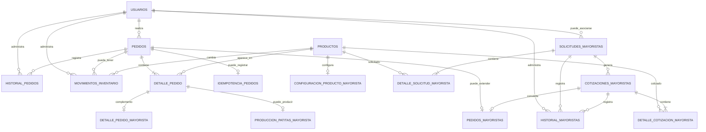
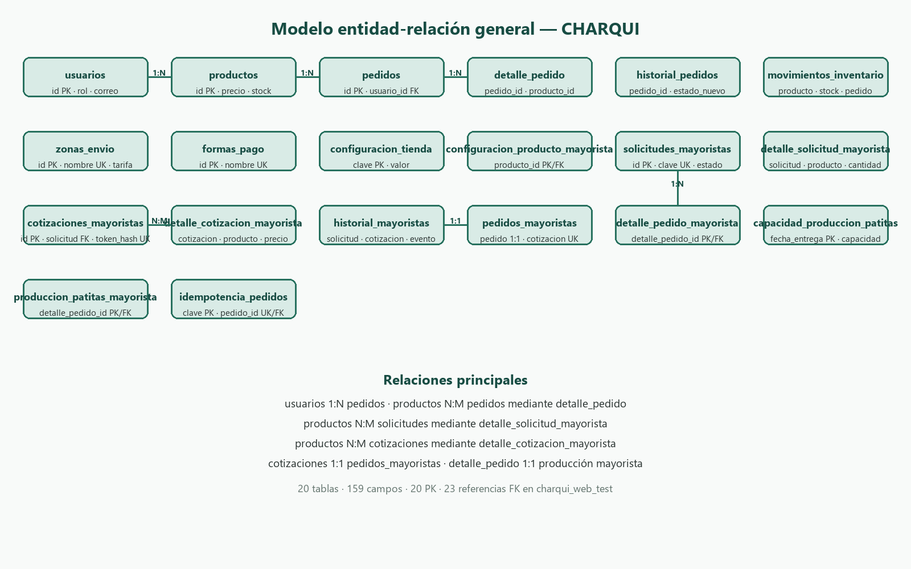
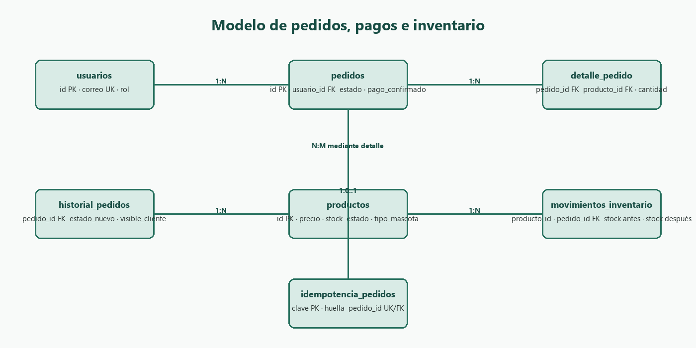
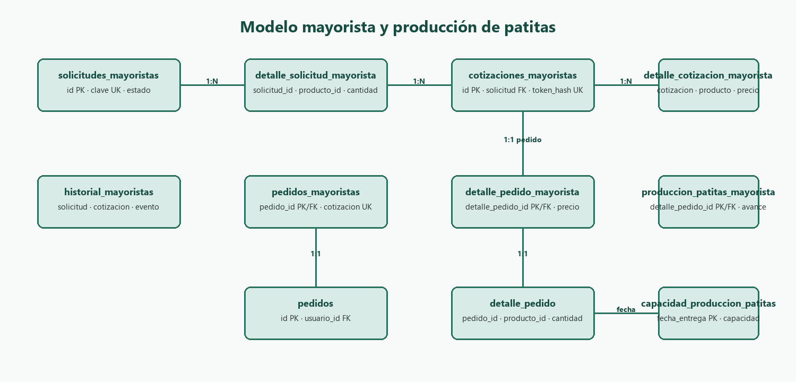
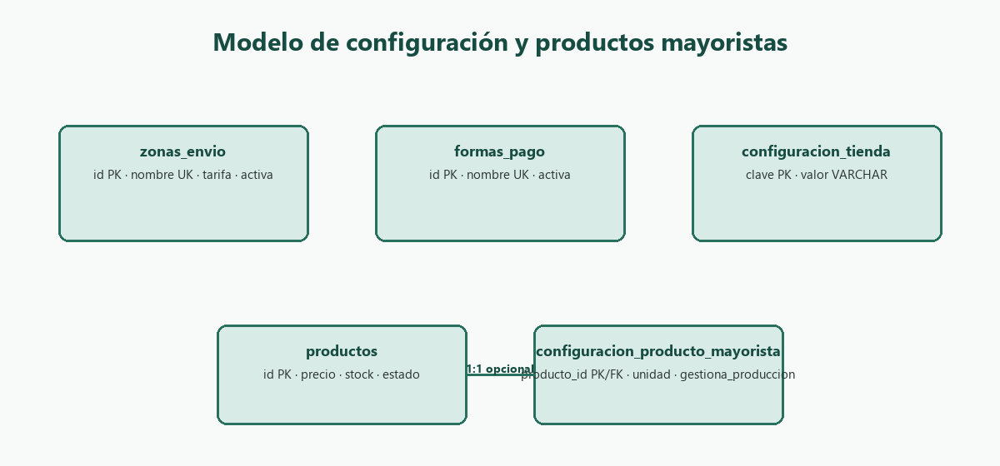

# Modelo de datos de la plataforma web CHARQUI

**Sistema:** CHARQUI  
**Motor identificado:** MariaDB/MySQL mediante `mysql2/promise`  
**Base principal declarada:** `charqui_web`  
**Base aislada contrastada:** `charqui_web_test`  
**Fecha de elaboración:** 26 de noviembre de 2026

Este documento representa la implementación real encontrada en `database/charqui.sql` y sus migraciones. No describe tablas propuestas ni reservas entidades que no estén respaldadas por el SQL o por el backend.

## Diagnóstico del esquema encontrado

La inspección confirmó 20 tablas. La conexión de solo lectura a `charqui_web_test` mostró la base exacta `charqui_web_test`, 20 tablas, 159 campos, 20 claves primarias y 23 columnas referenciadas mediante clave foránea. No se consultaron ni modificaron registros personales ni de negocio.

**Resultado de diferencias SQL:**

- El esquema base crea `usuarios`, `productos`, `pedidos` y `detalle_pedido`.
- `charqui.sql` ya incorpora extensiones iniciales para mascotas, promociones y envío.
- `migracion_admin_charqui.sql` agrega cédula, datos de entrega, estados ampliados, historial, inventario, zonas, formas de pago y configuración.
- `migracion_mayoristas.sql` agrega configuración mayorista, solicitudes, cotizaciones, historial comercial, conversión a pedido, producción y capacidad.
- `migracion_recomendador.sql` agrega la clasificación `textura` a productos.
- `migracion_idempotencia_pedidos.sql` agrega la tabla persistente de idempotencia.
- No se encontró una tabla separada de categorías ni una tabla persistente para el carrito: el carrito existe en `localStorage` del navegador.

**Tabla 1. Lista de tablas identificadas**

| N.º | Tabla | Módulo | Función |
|---:|---|---|---|
| 1 | `usuarios` | Usuarios y autenticación | Clientes y administradores |
| 2 | `productos` | Catálogo | Producto, precio, stock y clasificación |
| 3 | `pedidos` | Pedidos | Cabecera del pedido |
| 4 | `detalle_pedido` | Pedidos | Líneas de producto |
| 5 | `historial_pedidos` | Seguimiento | Cambios de estado |
| 6 | `movimientos_inventario` | Inventario | Entradas, ventas y ajustes |
| 7 | `zonas_envio` | Configuración | Zonas y tarifas |
| 8 | `formas_pago` | Configuración | Métodos activos |
| 9 | `configuracion_tienda` | Configuración | Valores clave/valor |
| 10 | `configuracion_producto_mayorista` | Mayoristas | Unidad y producción por producto |
| 11 | `solicitudes_mayoristas` | Mayoristas | Solicitud comercial |
| 12 | `detalle_solicitud_mayorista` | Mayoristas | Productos solicitados |
| 13 | `cotizaciones_mayoristas` | Mayoristas | Cotización y estado |
| 14 | `detalle_cotizacion_mayorista` | Mayoristas | Líneas de cotización |
| 15 | `historial_mayoristas` | Mayoristas | Actividad comercial |
| 16 | `pedidos_mayoristas` | Mayoristas | Pedido creado desde cotización |
| 17 | `detalle_pedido_mayorista` | Mayoristas | Precio histórico mayorista |
| 18 | `capacidad_produccion_patitas` | Producción | Capacidad por fecha |
| 19 | `produccion_patitas_mayorista` | Producción | Avance por detalle |
| 20 | `idempotencia_pedidos` | Pedidos | Reintentos seguros del checkout |

**Tabla 2. Índice de tablas de datos y archivos de diagramas**

| Entrega | Ubicación |
|---|---|
| Diagrama general | `documentacion/modelo_base_datos/diagrama_general.mmd` |
| Diagrama minorista y pedidos | `documentacion/modelo_base_datos/diagrama_pedidos_pagos_inventario.mmd` |
| Diagrama mayorista | `documentacion/modelo_base_datos/diagrama_mayoristas.mmd` |
| Diagrama configuración | `documentacion/modelo_base_datos/diagrama_configuracion.mmd` |

## Introducción

CHARQUI utiliza una base relacional administrada con MariaDB o MySQL. La estructura guarda usuarios, catálogo, pedidos, pagos marcados por la administración, movimientos de inventario, seguimiento por token, configuración comercial, solicitudes mayoristas, cotizaciones y producción.

## Objetivo del modelo

El modelo busca representar fielmente:

- todas las entidades implementadas;
- tipos y valores predeterminados;
- claves primarias y foráneas;
- restricciones de unicidad;
- relaciones uno a muchos y uno a uno;
- asociaciones muchos a muchos resueltas mediante tablas detalle;
- diferencias entre el SQL disponible y las validaciones adicionales del backend.

## Descripción general de la base

El núcleo comercial está formado por `usuarios`, `productos`, `pedidos` y `detalle_pedido`. `historial_pedidos` y `movimientos_inventario` conservan operaciones posteriores. `zonas_envio`, `formas_pago` y `configuracion_tienda` contienen configuración configurable.

El módulo mayorista usa `solicitudes_mayoristas`, sus detalles, cotizaciones y su historial. Una cotización aceptada puede generar un pedido registrado también en `pedidos`; `pedidos_mayoristas` agrega los datos exclusivos del mayorista.

## Modelo entidad-relación general

**Figura 1. Modelo entidad-relación general de CHARQUI**

**Nota.** Elaboración propia con los nombres de tablas y claves foráneas encontrados en el esquema real.

**Nota de la figura.** Vista general generada a partir del esquema real. Los archivos editables en Mermaid y las versiones SVG están disponibles en `docs/`.

## Cardinalidad y tablas intermedias

- `usuarios` — `pedidos`: 1:N. Un usuario puede tener muchos pedidos; cada pedido tiene un usuario.
- `pedidos` — `detalle_pedido`: 1:N. Una cabecera contiene una o más líneas.
- `productos` — `pedidos`: N:M mediante `detalle_pedido`.
- `pedidos_mayoristas` — `pedidos`: 1:1, porque su clave primaria es `pedido_id`.
- `detalle_pedido_mayorista` — `detalle_pedido`: 1:1, porque su clave primaria es `detalle_pedido_id`.
- `produccion_patitas_mayorista` — `detalle_pedido`: 1:1 opcional.
- `solicitudes_mayoristas` — `detalle_solicitud_mayorista`: 1:N.
- `productos` — `solicitudes_mayoristas`: N:M mediante `detalle_solicitud_mayorista`.
- `cotizaciones_mayoristas` — `detalle_cotizacion_mayorista`: 1:N.
- `productos` — `cotizaciones_mayoristas`: N:M mediante `detalle_cotizacion_mayorista`.
- `cotizaciones_mayoristas` — `pedidos_mayoristas`: 1:1, reforzada por `UNIQUE` en `cotizacion_id`.
- `productos` — `configuracion_producto_mayorista`: 1:1 opcional, puesto que el único campo clave es `producto_id`.

## Diccionario de datos

### 1. `usuarios`

| Campo | Tipo | Clave | Permite nulos | Predeterminado | Descripción |
|---|---|---|---|---|---|
| `id` | `INT UNSIGNED` | PK, AUTO_INCREMENT | No | Ninguno | Identificador interno del usuario. |
| `nombre` | `VARCHAR(100)` | - | No | Ninguno | Nombre visible del cliente o administrador. |
| `correo` | `VARCHAR(150)` | UNIQUE | No | Ninguno | Correo de acceso e identificación. |
| `contrasena` | `VARCHAR(255)` | - | Sí | Ninguno | Hash bcrypt administrativo o contraseña nula para clientes creados sin acceso. |
| `telefono` | `VARCHAR(30)` | - | No | Ninguno | Teléfono de contacto. |
| `cedula` | `VARCHAR(20)` | UNIQUE opcional | Sí | `NULL` | Cédula opcional del cliente. |
| `rol` | `ENUM('cliente','administrador')` | - | No | `cliente` | Rol usado para autorización. |

### 2. `productos`

| Campo | Tipo | Clave | Permite nulos | Predeterminado | Descripción |
|---|---|---|---|---|---|
| `id` | `INT UNSIGNED` | PK, AUTO_INCREMENT | No | Ninguno | Identificador del producto. |
| `nombre` | `VARCHAR(150)` | - | No | Ninguno | Nombre comercial. |
| `descripcion` | `TEXT` | - | No | Ninguno | Descripción e ingredientes usados por el catálogo y recomendador. |
| `precio` | `DECIMAL(10,2)` | - | No | Ninguno | Precio regular. |
| `stock` | `INT UNSIGNED` | - | No | `0` | Unidades minoristas disponibles. |
| `imagen` | `VARCHAR(255)` | - | Sí | `NULL` | Nombre o ruta de fotografía. |
| `estado` | `ENUM('disponible','agotado','inactivo')` | - | No | `disponible` | Visibilidad y disponibilidad comercial. |
| `tipo_mascota` | `ENUM('perro','gato','ambos')` | - | No | `ambos` | Especie objetivo. |
| `info_nutricional` | `TEXT` | - | Sí | `NULL` | Información nutricional mostrada en la ficha. |
| `presentaciones` | `VARCHAR(255)` | - | Sí | `NULL` | Presentaciones disponibles. |
| `precio_oferta` | `DECIMAL(10,2)` | - | Sí | `NULL` | Precio promocional opcional. |
| `textura` | `ENUM('crujiente','suave','sin_clasificar')` | - | No | `sin_clasificar` | Textura usada por el recomendador. |

### 3. `pedidos`

| Campo | Tipo | Clave | Permite nulos | Predeterminado | Descripción |
|---|---|---|---|---|---|
| `id` | `INT UNSIGNED` | PK, AUTO_INCREMENT | No | Ninguno | Identificador del pedido. |
| `usuario_id` | `INT UNSIGNED` | FK → `usuarios.id` | No | Ninguno | Cliente asociado. |
| `fecha` | `DATETIME` | - | No | `CURRENT_TIMESTAMP` | Fecha de registro. |
| `direccion_entrega` | `VARCHAR(255)` | - | No | Ninguno | Dirección principal. |
| `estado` | `ENUM` | - | No | `recibido_y_confirmado` | Estado actual ampliado por la migración administrativa. |
| `total` | `DECIMAL(10,2)` | - | No | Ninguno | Total del pedido. |
| `zona_entrega` | `VARCHAR(100)` | - | Sí | `NULL` | Zona seleccionada. |
| `costo_envio` | `DECIMAL(10,2)` | - | No | `0` | Tarifa calculada. |
| `forma_pago` | `VARCHAR(80)` | - | Sí | `NULL` | Método elegido o indicado. |
| `pago_confirmado` | `TINYINT(1)` | - | No | `0` | Indicador administrativo de pago confirmado. |
| `pago_confirmado_en` | `DATETIME` | - | Sí | `NULL` | Fecha de confirmación. |
| `pago_confirmado_por` | `INT UNSIGNED` | - | Sí | `NULL` | Identificador administrativo; no tiene FK declarada. |
| `provincia` | `VARCHAR(100)` | - | Sí | `NULL` | Provincia de entrega. |
| `ciudad` | `VARCHAR(100)` | - | Sí | `NULL` | Ciudad de entrega. |
| `sector` | `VARCHAR(150)` | - | Sí | `NULL` | Sector o barrio. |
| `calle_principal` | `VARCHAR(180)` | - | Sí | `NULL` | Calle principal. |
| `numero_domicilio` | `VARCHAR(40)` | - | Sí | `NULL` | Número de vivienda o edificio. |
| `calle_secundaria` | `VARCHAR(180)` | - | Sí | `NULL` | Calle secundaria. |
| `referencia` | `VARCHAR(255)` | - | Sí | `NULL` | Referencia de ubicación. |
| `latitud` | `DECIMAL(10,7)` | - | Sí | `NULL` | Coordenada opcional. |
| `longitud` | `DECIMAL(10,7)` | - | Sí | `NULL` | Coordenada opcional. |
| `repartidor_nombre` | `VARCHAR(120)` | - | Sí | `NULL` | Nombre del repartidor. |
| `salida_reparto` | `DATETIME` | - | Sí | `NULL` | Fecha y hora de salida. |
| `entregado_en` | `DATETIME` | - | Sí | `NULL` | Fecha de entrega. |
| `observaciones_entrega` | `TEXT` | - | Sí | `NULL` | Observaciones de reparto. |

El estado puede ser `recibido_y_confirmado`, `en_preparacion`, `listo_para_despacho`, `en_reparto_local`, `entregado`, `en_tu_puerta` o `cancelado`.

### 4. `detalle_pedido`

| Campo | Tipo | Clave | Permite nulos | Predeterminado | Descripción |
|---|---|---|---|---|---|
| `id` | `INT UNSIGNED` | PK, AUTO_INCREMENT | No | Ninguno | Identificador de la línea. |
| `pedido_id` | `INT UNSIGNED` | FK → `pedidos.id` | No | Ninguno | Cabecera propietaria. |
| `producto_id` | `INT UNSIGNED` | FK → `productos.id` | No | Ninguno | Producto comprado. |
| `cantidad` | `INT UNSIGNED` | - | No | Ninguno | Cantidad de unidades. |
| `subtotal` | `DECIMAL(10,2)` | - | No | Ninguno | Importe de la línea. |

### 5. `historial_pedidos`

| Campo | Tipo | Clave | Permite nulos | Predeterminado | Descripción |
|---|---|---|---|---|---|
| `id` | `INT UNSIGNED` | PK, AUTO_INCREMENT | No | Ninguno | Identificador del cambio. |
| `pedido_id` | `INT UNSIGNED` | FK → `pedidos.id` | No | Ninguno | Pedido cambiado. |
| `estado_anterior` | `VARCHAR(40)` | - | Sí | `NULL` | Estado previo. |
| `estado_nuevo` | `VARCHAR(40)` | - | No | Ninguno | Nuevo estado registrado. |
| `fecha_hora` | `DATETIME` | - | No | `CURRENT_TIMESTAMP` | Momento del cambio. |
| `administrador_id` | `INT UNSIGNED` | FK → `usuarios.id` | Sí | `NULL` | Administrador responsable. |
| `observacion` | `VARCHAR(500)` | - | Sí | `NULL` | Nota del cambio. |
| `visible_cliente` | `TINYINT(1)` | - | No | `0` | Permite mostrar la observación en seguimiento. |

### 6. `movimientos_inventario`

| Campo | Tipo | Clave | Permite nulos | Predeterminado | Descripción |
|---|---|---|---|---|---|
| `id` | `INT UNSIGNED` | PK, AUTO_INCREMENT | No | Ninguno | Identificador del movimiento. |
| `producto_id` | `INT UNSIGNED` | FK → `productos.id` | No | Ninguno | Producto afectado. |
| `tipo` | `ENUM('entrada','salida','ajuste','venta','devolucion')` | - | No | Ninguno | Naturaleza del movimiento. |
| `cantidad` | `INT UNSIGNED` | - | No | Ninguno | Unidades registradas. |
| `stock_anterior` | `INT UNSIGNED` | - | No | Ninguno | Existencia antes del movimiento. |
| `stock_nuevo` | `INT UNSIGNED` | - | No | Ninguno | Existencia después del movimiento. |
| `motivo` | `VARCHAR(500)` | - | Sí | `NULL` | Motivo de entrada, salida o ajuste. |
| `pedido_id` | `INT UNSIGNED` | FK → `pedidos.id` | Sí | `NULL` | Pedido vinculado a venta o devolución. |
| `administrador_id` | `INT UNSIGNED` | FK → `usuarios.id` | Sí | `NULL` | Administrador responsable. |
| `fecha_hora` | `DATETIME` | - | No | `CURRENT_TIMESTAMP` | Fecha del movimiento. |

Restricción UNIQUE compuesta: `(pedido_id, producto_id, tipo)`.

### 7. `zonas_envio`

| Campo | Tipo | Clave | Permite nulos | Predeterminado | Descripción |
|---|---|---|---|---|---|
| `id` | `INT UNSIGNED` | PK, AUTO_INCREMENT | No | Ninguno | Identificador de zona. |
| `nombre` | `VARCHAR(100)` | UNIQUE | No | Ninguno | Nombre mostrado al cliente. |
| `tarifa` | `DECIMAL(10,2)` | - | No | Ninguno | Costo de envío. |
| `envio_gratis` | `TINYINT(1)` | - | No | `0` | Indica elegibilidad por zona. |
| `activa` | `TINYINT(1)` | - | No | `1` | Permite activar o desactivar la zona. |

### 8. `formas_pago`

| Campo | Tipo | Clave | Permite nulos | Predeterminado | Descripción |
|---|---|---|---|---|---|
| `id` | `INT UNSIGNED` | PK, AUTO_INCREMENT | No | Ninguno | Identificador del método. |
| `nombre` | `VARCHAR(80)` | UNIQUE | No | Ninguno | Nombre visible. |
| `activa` | `TINYINT(1)` | - | No | `1` | Estado disponible. |

### 9. `configuracion_tienda`

| Campo | Tipo | Clave | Permite nulos | Predeterminado | Descripción |
|---|---|---|---|---|---|
| `clave` | `VARCHAR(80)` | PK | No | Ninguno | Nombre de la configuración. |
| `valor` | `VARCHAR(255)` | - | No | Ninguno | Valor almacenado como texto. |

### 10. `configuracion_producto_mayorista`

| Campo | Tipo | Clave | Permite nulos | Predeterminado | Descripción |
|---|---|---|---|---|---|
| `producto_id` | `INT UNSIGNED` | PK, FK → `productos.id` | No | Ninguno | Producto configurado. |
| `unidad` | `VARCHAR(40)` | - | No | Ninguno | Unidad mayorista, por ejemplo `patita`. |
| `gestiona_produccion` | `TINYINT(1)` | - | No | `0` | Indica si se controla por producción y no stock minorista. |

### 11. `solicitudes_mayoristas`

| Campo | Tipo | Clave | Permite nulos | Predeterminado | Descripción |
|---|---|---|---|---|---|
| `id` | `INT UNSIGNED` | PK, AUTO_INCREMENT | No | Ninguno | Identificador de solicitud. |
| `clave_solicitud` | `CHAR(36)` | UNIQUE | No | Ninguno | Clave persistente contra reintentos. |
| `negocio` | `VARCHAR(150)` | - | No | Ninguno | Nombre del negocio. |
| `contacto` | `VARCHAR(120)` | - | No | Ninguno | Persona de contacto. |
| `telefono` | `VARCHAR(30)` | - | No | Ninguno | Teléfono. |
| `whatsapp` | `VARCHAR(30)` | - | No | Ninguno | WhatsApp de contacto. |
| `correo` | `VARCHAR(150)` | - | No | Ninguno | Correo comercial. |
| `provincia` | `VARCHAR(100)` | - | No | Ninguno | Provincia del negocio. |
| `ciudad` | `VARCHAR(100)` | - | No | Ninguno | Ciudad del negocio. |
| `sector_direccion` | `VARCHAR(255)` | - | Sí | `NULL` | Dirección o sector opcional. |
| `tipo_negocio` | `VARCHAR(80)` | - | No | Ninguno | Tipo comercial declarado. |
| `otro_tipo_negocio` | `VARCHAR(100)` | - | Sí | `NULL` | Detalle si se elige otro tipo. |
| `observaciones` | `TEXT` | - | Sí | `NULL` | Observaciones del cliente. |
| `consentimiento_datos` | `TINYINT(1)` | - | No | `0` | Confirmación de uso de datos. |
| `estado` | `ENUM` | - | No | `nueva` | Estado de revisión o cotización. |
| `usuario_id` | `INT UNSIGNED` | FK → `usuarios.id` | Sí | `NULL` | Usuario creado o asociado al convertir. |
| `fecha` | `DATETIME` | - | No | `CURRENT_TIMESTAMP` | Fecha de solicitud. |
| `actualizado_en` | `DATETIME` | - | No | `CURRENT_TIMESTAMP ON UPDATE` | Última actualización. |

Estados: `nueva`, `en_revision`, `cotizacion_preparada`, `cotizacion_enviada`, `aceptada`, `rechazada`, `vencida` y `convertida_en_pedido`.

### 12. `detalle_solicitud_mayorista`

| Campo | Tipo | Clave | Permite nulos | Predeterminado | Descripción |
|---|---|---|---|---|---|
| `id` | `INT UNSIGNED` | PK, AUTO_INCREMENT | No | Ninguno | Identificador de línea. |
| `solicitud_id` | `INT UNSIGNED` | FK → `solicitudes_mayoristas.id` | No | Ninguno | Solicitud propietaria. |
| `producto_id` | `INT UNSIGNED` | FK → `productos.id` | No | Ninguno | Producto solicitado. |
| `nombre_producto` | `VARCHAR(150)` | - | No | Ninguno | Copia histórica del nombre. |
| `presentacion` | `VARCHAR(255)` | - | Sí | `NULL` | Copia histórica de presentación. |
| `unidad` | `VARCHAR(40)` | - | No | Ninguno | Unidad solicitada. |
| `gestiona_produccion` | `TINYINT(1)` | - | No | `0` | Indica control por producción. |
| `cantidad` | `INT UNSIGNED` | - | No | Ninguno | Cantidad solicitada. |

### 13. `cotizaciones_mayoristas`

| Campo | Tipo | Clave | Permite nulos | Predeterminado | Descripción |
|---|---|---|---|---|---|
| `id` | `INT UNSIGNED` | PK, AUTO_INCREMENT | No | Ninguno | Identificador de cotización. |
| `solicitud_id` | `INT UNSIGNED` | FK → `solicitudes_mayoristas.id` | No | Ninguno | Solicitud origen. |
| `estado` | `ENUM` | - | No | `borrador` | Estado actual. |
| `token_hash` | `CHAR(64) CHARACTER SET ascii COLLATE ascii_bin` | UNIQUE | Sí | `NULL` | Hash del token privado; no almacena el token claro. |
| `subtotal` | `DECIMAL(12,2)` | - | No | `0` | Suma antes de descuento y envío. |
| `descuento` | `DECIMAL(12,2)` | - | No | `0` | Descuento aplicado. |
| `envio` | `DECIMAL(12,2)` | - | No | `0` | Costo de envío. |
| `total` | `DECIMAL(12,2)` | - | No | `0` | Total calculado. |
| `condiciones_pago` | `VARCHAR(500)` | - | Sí | `NULL` | Condiciones mostradas. |
| `vigencia` | `DATE` | - | Sí | `NULL` | Fecha límite opcional. |
| `observaciones_internas` | `TEXT` | - | Sí | `NULL` | Notas administrativas. |
| `fecha` | `DATETIME` | - | No | `CURRENT_TIMESTAMP` | Fecha de creación. |
| `actualizado_en` | `DATETIME` | - | No | `CURRENT_TIMESTAMP ON UPDATE` | Última actualización. |

Estados: `borrador`, `preparada`, `enviada`, `aceptada`, `rechazada`, `vencida` y `convertida_en_pedido`.

### 14. `detalle_cotizacion_mayorista`

| Campo | Tipo | Clave | Permite nulos | Predeterminado | Descripción |
|---|---|---|---|---|---|
| `id` | `INT UNSIGNED` | PK, AUTO_INCREMENT | No | Ninguno | Identificador de línea. |
| `cotizacion_id` | `INT UNSIGNED` | FK → `cotizaciones_mayoristas.id` | No | Ninguno | Cotización propietaria. |
| `producto_id` | `INT UNSIGNED` | FK → `productos.id` | No | Ninguno | Producto cotizado. |
| `nombre_producto` | `VARCHAR(150)` | - | No | Ninguno | Copia histórica del nombre. |
| `presentacion` | `VARCHAR(255)` | - | Sí | `NULL` | Presentación usada en la cotización. |
| `unidad` | `VARCHAR(40)` | - | No | Ninguno | Unidad acordada. |
| `gestiona_produccion` | `TINYINT(1)` | - | No | `0` | Indica control por producción. |
| `cantidad` | `INT UNSIGNED` | - | No | Ninguno | Cantidad cotizada. |
| `precio_unitario` | `DECIMAL(10,3)` | - | No | Ninguno | Precio unitario acordado. |
| `subtotal` | `DECIMAL(12,2)` | - | No | Ninguno | Importe de la línea. |

### 15. `historial_mayoristas`

| Campo | Tipo | Clave | Permite nulos | Predeterminado | Descripción |
|---|---|---|---|---|---|
| `id` | `INT UNSIGNED` | PK, AUTO_INCREMENT | No | Ninguno | Identificador de actividad. |
| `solicitud_id` | `INT UNSIGNED` | FK → `solicitudes_mayoristas.id` | No | Ninguno | Solicitud afectada. |
| `cotizacion_id` | `INT UNSIGNED` | FK → `cotizaciones_mayoristas.id` | Sí | `NULL` | Cotización relacionada. |
| `administrador_id` | `INT UNSIGNED` | FK → `usuarios.id` | Sí | `NULL` | Administrador que ejecutó la acción. |
| `evento` | `VARCHAR(80)` | - | No | Ninguno | Tipo de actividad. |
| `detalle` | `TEXT` | - | Sí | `NULL` | Información adicional. |
| `fecha` | `DATETIME` | - | No | `CURRENT_TIMESTAMP` | Momento del evento. |

### 16. `pedidos_mayoristas`

| Campo | Tipo | Clave | Permite nulos | Predeterminado | Descripción |
|---|---|---|---|---|---|
| `pedido_id` | `INT UNSIGNED` | PK, FK → `pedidos.id` | No | Ninguno | Cabecera compartida del pedido. |
| `cotizacion_id` | `INT UNSIGNED` | UNIQUE, FK → `cotizaciones_mayoristas.id` | No | Ninguno | Cotización origen. |
| `fecha_entrega` | `DATE` | - | No | Ninguno | Fecha acordada. |
| `condiciones_pago` | `VARCHAR(500)` | - | Sí | `NULL` | Condiciones heredadas. |
| `descuento` | `DECIMAL(12,2)` | - | No | `0` | Descuento aplicado. |
| `envio` | `DECIMAL(12,2)` | - | No | `0` | Envío aplicado. |

### 17. `detalle_pedido_mayorista`

| Campo | Tipo | Clave | Permite nulos | Predeterminado | Descripción |
|---|---|---|---|---|---|
| `detalle_pedido_id` | `INT UNSIGNED` | PK, FK → `detalle_pedido.id` | No | Ninguno | Línea compartida minorista/mayorista. |
| `nombre_producto` | `VARCHAR(150)` | - | No | Ninguno | Nombre histórico acordado. |
| `precio_unitario` | `DECIMAL(10,3)` | - | No | Ninguno | Precio exacto mayorista. |

### 18. `capacidad_produccion_patitas`

| Campo | Tipo | Clave | Permite nulos | Predeterminado | Descripción |
|---|---|---|---|---|---|
| `fecha_entrega` | `DATE` | PK | No | Ninguno | Fecha de entrega planificada. |
| `capacidad_unidades` | `INT UNSIGNED` | - | No | Ninguno | Capacidad máxima registrada. |
| `actualizado_en` | `DATETIME` | - | No | `CURRENT_TIMESTAMP ON UPDATE` | Última actualización. |

### 19. `produccion_patitas_mayorista`

| Campo | Tipo | Clave | Permite nulos | Predeterminado | Descripción |
|---|---|---|---|---|---|
| `detalle_pedido_id` | `INT UNSIGNED` | PK, FK → `detalle_pedido.id` | No | Ninguno | Línea que se produce. |
| `fecha_entrega` | `DATE` | - | No | Ninguno | Fecha comprometida. |
| `unidades_pedidas` | `INT UNSIGNED` | - | No | Ninguno | Cantidad solicitada. |
| `unidades_producidas` | `INT UNSIGNED` | - | No | `0` | Cantidad producida. |
| `unidades_listas` | `INT UNSIGNED` | - | No | `0` | Cantidad lista para entrega. |
| `unidades_entregadas` | `INT UNSIGNED` | - | No | `0` | Cantidad entregada. |
| `actualizado_en` | `DATETIME` | - | No | `CURRENT_TIMESTAMP ON UPDATE` | Última actualización. |

Índice: `(fecha_entrega)`.

### 20. `idempotencia_pedidos`

| Campo | Tipo | Clave | Permite nulos | Predeterminado | Descripción |
|---|---|---|---|---|---|
| `clave` | `CHAR(36) CHARACTER SET ascii COLLATE ascii_bin` | PK | No | Ninguno | UUID de intento de checkout. |
| `huella_solicitud` | `CHAR(64) CHARACTER SET ascii COLLATE ascii_bin` | - | No | Ninguno | Hash SHA-256 normalizado de la solicitud. |
| `pedido_id` | `INT UNSIGNED` | UNIQUE, FK → `pedidos.id` | Sí | `NULL` | Pedido generado por la clave; puede estar temporalmente vacío. |
| `creado_en` | `DATETIME` | - | No | `CURRENT_TIMESTAMP` | Fecha del registro idempotente. |

## Descripción de relaciones

### Usuarios y autenticación

`usuarios.rol` distingue clientes y administradores. Los pedidos usan `usuario_id`, mientras las acciones administrativas se vinculan mediante `administrador_id` en movimientos e historiales. `pedidos.pago_confirmado_por` no declara una FK; por tanto su integridad referencial no queda garantizada por MariaDB.

El acceso JWT no crea una tabla de sesiones. Las credenciales administrativas se almacenan como hash bcrypt en `contrasena`.

### Productos y catálogo

No existe una tabla de categorías. La clasificación se implementa mediante los campos `tipo_mascota` y `textura`, además de `estado`, `stock` y `precio_oferta`. `configuracion_producto_mayorista` proporciona datos adicionales mayoristas.

### Carrito y pedidos

El carrito no persiste en SQL. Se representa en `localStorage` del navegador y se transforma en una cabecera `pedidos` y múltiples registros `detalle_pedido` al confirmar. Las líneas forman la relación N:M productos-pedidos.

### Pagos y confirmaciones

No existe una tabla de pagos ni transacciones bancarias. `pedidos.pago_confirmado` y sus columnas de auditoría representan el estado confirmado por administración. Los importes de reportes se calculan sobre `pedidos`.

### Inventario

`movimientos_inventario` registra una operación y conserva stock antes y después. Algunos movimientos se vinculan a pedidos mediante `pedido_id`. La venta y devolución se distinguen por `tipo`.

### Envíos y direcciones

`zonas_envio` y `formas_pago` son tablas independientes; no hay FK desde `pedidos` a ellas. `pedidos.zona_entrega` y `pedidos.forma_pago` almacenan texto. Las direcciones detalladas se encuentran directamente en columnas de `pedidos`.

### Seguimiento

No existe tabla de enlaces de seguimiento. El identificador JWT codifica el número de pedido y el endpoint privado lo verifica. `historial_pedidos.visible_cliente` controla qué cambios puede ver el cliente.

### Mayoristas

Las solicitudes generan cotizaciones y pueden asociarse opcionalmente a usuarios. Los detalles se distribuyen en tablas separadas para solicitud y cotización. Una cotización aceptada se convierte en una cabecera `pedidos`, una relación `pedidos_mayoristas` y detalles compartidos.

### Administración y configuración

`configuracion_tienda` usa una clave primaria texto. `zonas_envio` y `formas_pago` mantienen valores comerciales activos. Los historiales referencian administradores opcionalmente.

## Normalización

### Primera forma normal

La base usa campos escalares y tablas detalle. No se encontraron campos multivaluados declarados en una sola columna. Los campos `detalles` se separan en varias tablas.

### Segunda forma normal

Las entidades con clave simple permiten identificar dependencias funcionales completas. Las tablas detalle almacenan atributos propios de la relación.

### Tercera forma normal

En general, el modelo evita repetir atributos maestros en pedidos. Sin embargo, existen redundancias controladas y justificaciones históricas:

- nombres y presentaciones se copian en detalles de solicitud y cotización;
- nombres y precios mayoristas se conservan al crear detalles;
- `pedidos.zona_entrega` y `pedidos.forma_pago` se almacenan como texto en lugar de claves foráneas;
- `pago_confirmado_por` no referencia usuarios;
- `configuracion_tienda` conserva valores en texto;
- `detalle_pedido_mayorista` conserva precio exacto acordado;
- el stock se duplica como dato actual en `productos` y como historial antes/después en `movimientos_inventario`.

Las copias históricas son necesarias para mantener el importe o nombre aunque luego cambie el catálogo. Las principales oportunidades de mejora serían normalizar zona y método de pago con claves foráneas y crear una tabla de pagos separada, pero no se realizaron cambios.

## Reglas de integridad

### Claves primarias

Todas las tablas tienen clave primaria. Las tablas extensivas `configuracion_producto_mayorista`, `pedidos_mayoristas`, `detalle_pedido_mayorista`, `capacidad_produccion_patitas`, `produccion_patitas_mayorista` utilizan claves simples que representan relaciones 1:1.

### Claves foráneas

La inspección aislada confirmó 23 referencias con nombres automáticos o explícitos. No se encontraron instrucciones `ON DELETE` ni `ON UPDATE` dentro de los archivos SQL revisados. Por ello MariaDB aplica el comportamiento predeterminado del motor, normalmente restricción.

### UNIQUE

Restricciones importantes:

- `usuarios.correo`;
- `usuarios.cedula`;
- `zonas_envio.nombre`;
- `formas_pago.nombre`;
- `solicitudes_mayoristas.clave_solicitud`;
- `cotizaciones_mayoristas.token_hash`;
- `(pedido_id, producto_id, tipo)` en `movimientos_inventario`;
- `pedidos_mayoristas.cotizacion_id`;
- `idempotencia_pedidos.pedido_id`;

### NOT NULL y valores predeterminados

Los campos críticos usan `NOT NULL`. Los campos opcionales mantienen `NULL`. Las marcas booleanas usan `TINYINT(1)` con predeterminados 0 o 1.

### CHECK y validación backend

No se encontraron cláusulas SQL `CHECK` en los archivos. Los valores `ENUM` restringen varios estados. El backend aplica validaciones adicionales para teléfonos, correos, coordenadas, cantidades, UUID, claves, estados permitidos y rangos.

## Diagramas por módulos

Los archivos complementarios de Mermaid permiten visualizar el modelo sin omitir entidades:

- `diagrama_general.mmd`: todas las relaciones principales;
- `diagrama_pedidos_pagos_inventario.mmd`: pedidos, usuarios, productos, detalles e inventario;
- `diagrama_mayoristas.mmd`: solicitudes, cotizaciones, producción y conversión;
- `diagrama_configuracion.mmd`: zonas, formas de pago y configuración.

### Figura 2. Modelo de pedidos, pagos e inventario

**Nota.** Imagen exportada en formato PNG. El diagrama editable correspondiente se encuentra en `docs/diagrama_pedidos_pagos_inventario_charqui.mmd`.

### Figura 3. Modelo mayorista y producción

**Nota.** Imagen exportada en formato PNG. El diagrama editable correspondiente se encuentra en `docs/diagrama_mayoristas_charqui.mmd`.

### Figura 4. Modelo de configuración

**Nota.** Imagen exportada en formato PNG. El diagrama editable correspondiente se encuentra en `docs/diagrama_configuracion_charqui.mmd`.

## Conclusiones

La base implementada cuenta con 20 tablas y 159 campos. El núcleo minorista es relacional y normalizado: usuarios, productos, pedidos y líneas. El módulo mayorista agrega entidades auxiliares para solicitudes, cotizaciones, actividad comercial y producción.

Las principales desviaciones respecto de una tercera forma normal estricta son copias históricas necesarias para conservar nombres y precios. Las principales limitaciones son la ausencia de una tabla de pagos, la falta de FK para `pago_confirmado_por` y el almacenamiento textual de zona y forma de pago en pedidos.

No se realizaron migraciones ni cambios de datos. El modelo fue contrastado con una consulta de solo lectura a `charqui_web_test`.
