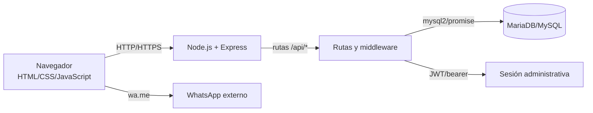
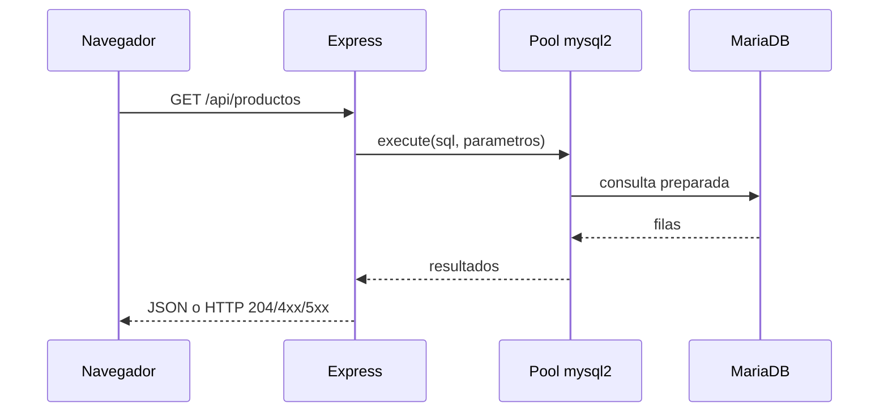
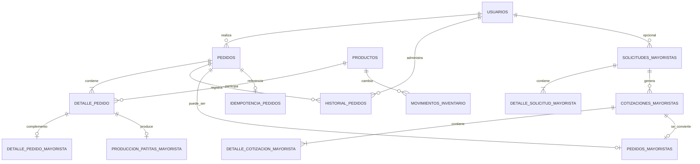
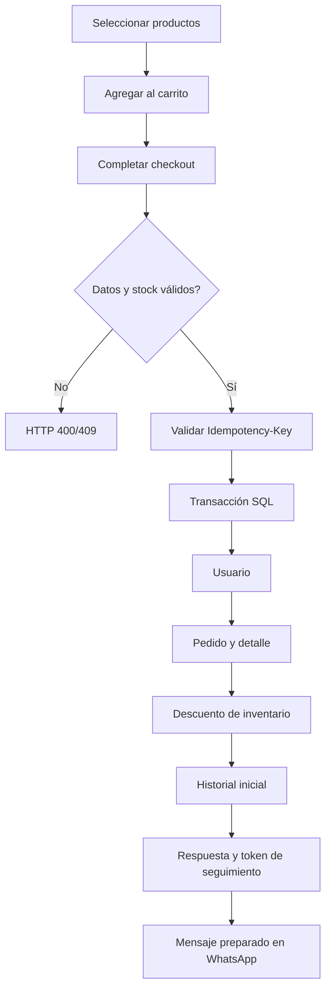
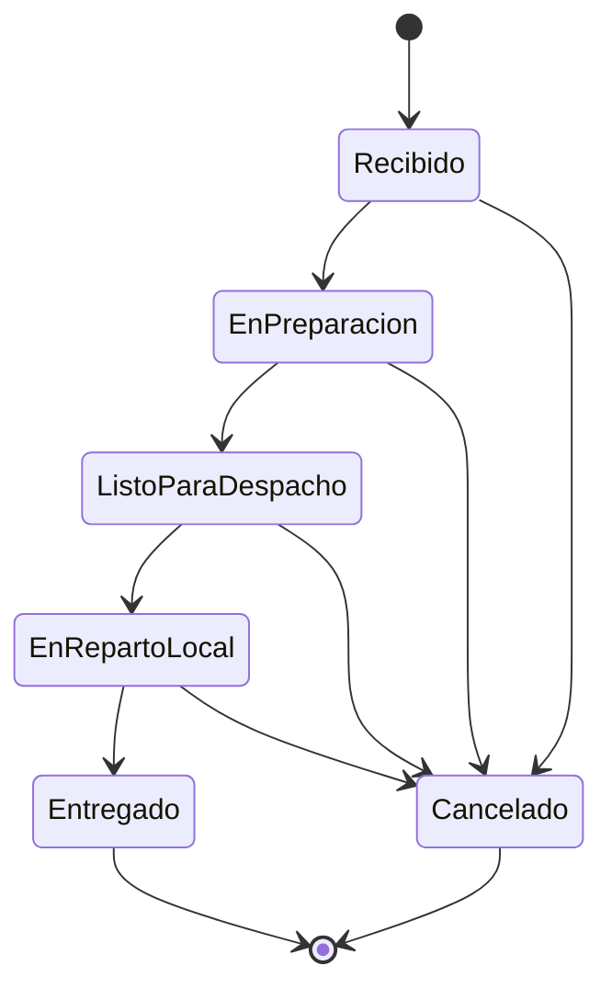
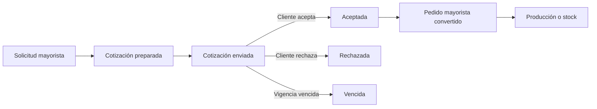
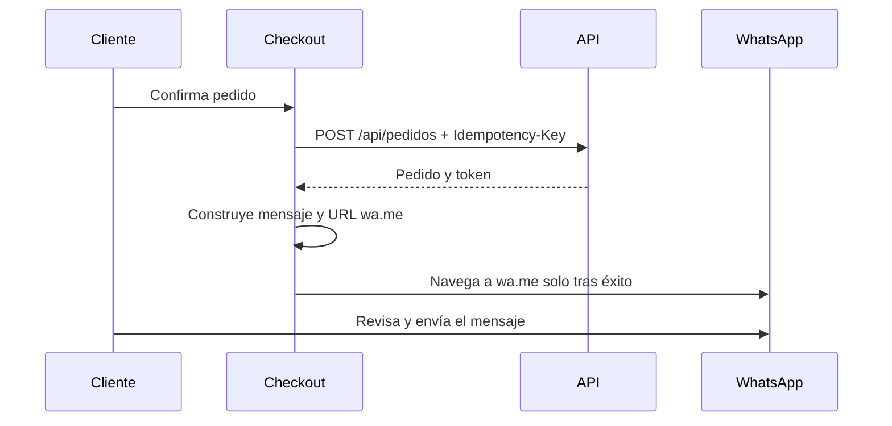

# Manual técnico del sistema web CHARQUI

**Proyecto:** CHARQUI — comercio electrónico de snacks deshidratados naturales para mascotas  
**Versión técnica revisada:** paquete `1.0.0`; motor y entorno: Node.js declarado `20.x`  
**Motor de datos identificado:** MariaDB/MySQL mediante `mysql2/promise`  
**Fecha de elaboración:** 26 de noviembre de 2026  
**Clasificación:** documentación técnica académica

> Este documento describe exclusivamente componentes comprobados en el repositorio y en las páginas reales compartidas. Cuando un dato no pudo verificarse, se identifica como pendiente y no se presenta como supuesto.

---

## Índice general

1. [Capítulo 1. Introducción](#capítulo-1-introducción)  
2. [Capítulo 2. Arquitectura del sistema](#capítulo-2-arquitectura-del-sistema)  
3. [Capítulo 3. Estructura del proyecto](#capítulo-3-estructura-del-proyecto)  
4. [Capítulo 4. Base de datos](#capítulo-4-base-de-datos)  
5. [Capítulo 5. Funcionamiento del backend](#capítulo-5-funcionamiento-del-backend)  
6. [Capítulo 6. Funcionamiento del frontend](#capítulo-6-funcionamiento-del-frontend)  
7. [Capítulo 7. Seguridad del sistema](#capítulo-7-seguridad-del-sistema)  
8. [Capítulo 8. Instalación y configuración](#capítulo-8-instalación-y-configuración)  
9. [Capítulo 9. Pruebas y validación](#capítulo-9-pruebas-y-validación)  
10. [Capítulo 10. Mantenimiento y solución de problemas](#capítulo-10-mantenimiento-y-solución-de-problemas)  
11. [Datos pendientes de confirmación](#datos-pendientes-de-confirmación)

### Índice de tablas

- Tabla 1. Diagnóstico de información disponible
- Tabla 2. Tecnologías verificadas
- Tabla 3. Función de los directorios principales
- Tabla 4. Archivos técnicos principales
- Tabla 5. Rutas API montadas por el servidor
- Tabla 6. Tablas principales y su propósito
- Tabla 7. Relaciones principales del modelo
- Tabla 8. Endpoints públicos y su acceso
- Tabla 9. Endpoints administrativos
- Tabla 10. Acciones administrativas sobre pedidos y pagos
- Tabla 11. Páginas frontend y responsabilidades
- Tabla 12. Controles de seguridad implementados
- Tabla 13. Variables de entorno
- Tabla 14. Comandos operativos
- Tabla 15. Pruebas ejecutadas y estado
- Tabla 16. Matriz de pruebas pendientes
- Tabla 17. Problemas comunes y acciones

### Índice de figuras

- Figura 1. Arquitectura general de CHARQUI
- Figura 2. Comunicación HTTP y acceso a datos
- Figura 3. Modelo entidad-relación simplificado
- Figura 4. Flujo de compra de un cliente
- Figura 5. Proceso administrativo de pedidos
- Figura 6. Integración con WhatsApp
- Figura 7. Flujo mayorista
- Figura 8. Interfaz real revisada del módulo Existencias

## Diagnóstico inicial

| Área | Estado | Evidencia |
|---|---|---|
| Arquitectura y tecnologías | Comprobado | `package.json`, `backend/servidor.js`, archivos frontend y dependencias instaladas. |
| Estructura de carpetas | Comprobado | Repositorio inspeccionado. |
| Esquema SQL | Comprobado parcialmente | `database/charqui.sql` y tres migraciones principales permiten reconstruir 20 entidades técnicas identificadas. No se realizó comparación directa contra `charqui_web` ni una migración. |
| Rutas backend | Comprobado | 43 declaraciones de rutas identificadas en `backend/rutas`. |
| Seguridad | Comprobado en código y pruebas | JWT, bcrypt, CORS, límites de solicitudes, encabezados HTTP, seguimiento con token. |
| Pruebas | Comprobado | 9/10 seleccionadas aprobaron; una integración MariaDB fue omitida al no estar configurada la variable `CHARQUI_TEST_DB_ENV` en esta ejecución. |
| Interfaz real | Comprobado parcialmente | Se revisó el panel administrativo compartido y el módulo **Existencias** estaba activo. No se conservaron capturas locales automatizadas de esta sesión. |

**Tabla 1. Diagnóstico de información disponible.**

## Capítulo 1. Introducción

### 1.1 Propósito del manual

Este manual describe cómo está construido, instalado y mantenido el sistema web CHARQUI. Su propósito es que una persona técnica pueda comprender la arquitectura, reproducir un entorno compatible, ubicar las responsabilidades de cada módulo y aplicar tareas básicas de operación sin consultar únicamente el código.

### 1.2 Alcance

Incluye el frontend estático, el servidor Node.js y Express, el acceso a MariaDB/MySQL, las rutas API, los mecanismos de autenticación, el seguimiento privado, los pedidos minoristas y mayoristas, el inventario, los pagos, los reportes y las migraciones existentes.

No sustituye una política de despliegue ni una auditoría de infraestructura. No incluye valores reales de secretos, contraseñas ni credenciales. Tampoco valida un servidor de producción que no esté disponible para inspección.

### 1.3 Objetivos

1. Identificar los componentes reales del sistema.
2. Documentar la comunicación entre navegador, API y base de datos.
3. Describir el esquema disponible sin atribuirle entidades no presentes.
4. Explicar instalación y operación compatibles con Windows y PowerShell.
5. Registrar qué pruebas fueron ejecutadas y cuáles siguen pendientes.
6. Diferenciar módulos comprobados de datos todavía pendientes.

### 1.4 Público

Está dirigido a estudiantes y docentes del proyecto académico, administradores técnicos, desarrolladores que deben continuar el software y personal responsable de respaldos y despliegues.

### 1.5 Descripción general

CHARQUI es una tienda web para consultar snacks deshidratados naturales para mascotas, preparar pedidos minoristas, coordinar pagos por WhatsApp y atender solicitudes de cotización mayorista desde un panel administrativo.

El frontend está compuesto por HTML, CSS y JavaScript sin un framework SPA. El backend es una aplicación Express que expone archivos estáticos y rutas API REST. Los datos se almacenan mediante un pool `mysql2/promise`.

## Capítulo 2. Arquitectura del sistema

### 2.1 Estilo arquitectónico

La aplicación usa una arquitectura cliente-servidor de tres niveles:

1. **Presentación:** HTML, CSS y JavaScript en `frontend/`.
2. **Lógica de aplicación:** Express y módulos JavaScript en `backend/`.
3. **Datos:** MariaDB/MySQL accedido con `mysql2/promise`.

No se encontró un framework frontend, empaquetador ni compilador configurado. Las páginas cargan scripts concretos mediante etiquetas `<script>`. El backend sirve directamente `frontend/`.

**Figura 1. Arquitectura general de CHARQUI**



**Nota.** Elaboración propia basada en `backend/servidor.js`, los scripts frontend y las rutas API. WhatsApp es un servicio externo y no forma parte del servidor.

### 2.2 Tecnologías utilizadas

| Componente | Tecnología | Versión comprobada o declaración |
|---|---|---|
| Lenguaje backend/frontend | JavaScript | Node.js 20.x declarado en el proyecto. |
| Entorno ejecutado en esta inspección | Node.js | v24.11.1; no se confirmó Node 20 durante esta revisión. |
| Servidor HTTP | Express | 4.22.3 en `package-lock.json`. |
| Base de datos | MariaDB/MySQL | MariaDB 10.4.32 documentado en validaciones anteriores. |
| Conector SQL | mysql2 | 3.24.6 en `package-lock.json`. |
| Contraseñas | bcrypt | 5.1.1. |
| Autenticación | jsonwebtoken | 9.0.3. |
| Variables de entorno | dotenv | 16.6.1. |
| CORS | cors | 2.8.6. |
| Pruebas | `node:test` integrado | Sin framework externo identificado. |
| Frontend | HTML5, CSS3 y JavaScript nativo | Sin framework ni biblioteca SPA. |

**Tabla 2. Tecnologías verificadas.** Las versiones exactas corresponden al lockfile; el entorno ejecutado no coincide con la declaración Node 20.x.

### 2.3 Comunicación

**Figura 2. Comunicación HTTP y acceso a datos**



Las consultas usan `execute` o `getConnection` para transacciones. Las respuestas se expresan en JSON salvo archivos estáticos, CSV, HTML y errores controlados.

## Capítulo 3. Estructura del proyecto

### 3.1 Directorios principales

| Directorio o archivo | Función |
|---|---|
| `frontend/` | Páginas HTML, hojas CSS, scripts JavaScript e imágenes. |
| `frontend/js/` | Lógica de catálogo, carrito, checkout, administración y mayoristas. |
| `frontend/css/` | Estilos compartidos e interfaz responsive. |
| `frontend/img/` | Fotografías y recursos visuales. |
| `backend/` | Servidor, conexión, rutas, middleware, servicios y pruebas. |
| `backend/rutas/` | Rutas REST por dominio funcional. |
| `backend/middleware/` | Autorización administrativa y limitación de solicitudes. |
| `backend/servicios/` | Servicios compartidos, incluido seguimiento privado. |
| `backend/utilidades/` | Validaciones y configuración de seguridad. |
| `backend/test/` | Pruebas de seguridad, HTTP y MariaDB. |
| `database/` | SQL base y migraciones SQL. |
| `docs/` | Documentación técnica y de usuario. |
| `scripts/` | Utilidades auxiliares de documentación. |

**Tabla 3. Función de los directorios principales.**

### 3.2 Archivos importantes

| Archivo | Responsabilidad |
|---|---|
| `package.json` | Nombre, versión, motor Node declarado y dependencias. |
| `package-lock.json` | Resolución exacta de dependencias. |
| `.env` | Configuración local habitual; no debe versionarse ni exponerse. |
| `backend/servidor.js` | Seguridad HTTP básica, CORS, JSON, archivos estáticos y montaje de API. |
| `backend/base_datos.js` | Pool MariaDB/MySQL. |
| `backend/crear_admin.js` | Creación inicial de una cuenta administradora. |
| `backend/middleware/administrador.js` | Verifica JWT administrativo. |
| `backend/middleware/limitador_solicitudes.js` | Limita solicitudes por dirección IP en memoria. |
| `backend/servicios/seguimiento_pedido.js` | Genera y verifica tokens privados. |
| `database/charqui.sql` | Esquema base y ampliaciones iniciales. |
| `database/migracion_admin_charqui.sql` | Administración, inventario, envíos y pagos. |
| `database/migracion_mayoristas.sql` | Solicitudes, cotizaciones, producción y pedidos mayoristas. |
| `database/migracion_recomendador.sql` | Clasificación de textura para recomendaciones. |
| `database/migracion_idempotencia_pedidos.sql` | Tabla persistente para crear pedidos una sola vez por clave. |

**Tabla 4. Archivos técnicos principales.**

### 3.3 Montaje de rutas

| Prefijo | Módulo |
|---|---|
| `/api/auth` | Inicio de sesión administrativo |
| `/api/productos` | Catálogo y gestión de productos |
| `/api/mayoristas` | Solicitudes y cotizaciones mayoristas |
| `/api/ofertas` | Productos con precio de oferta |
| `/api/clientes` | Consulta administrativa simple de clientes |
| `/api/administracion` | Dashboard, pedidos, entregas, inventario, clientes y reportes |
| `/api/pedidos` | Creación, seguimiento y administración de pedidos |
| `/api/envios` | Zonas, tarifas y formas de pago |

**Tabla 5. Rutas API montadas por el servidor.**

## Capítulo 4. Base de datos

### 4.1 Motor y nombres

El código usa `mysql2/promise` y puede conectarse a MySQL o MariaDB. Las validaciones anteriores identificaron MariaDB 10.4.32. El esquema SQL crea por defecto la base `charqui_web`. Existe un entorno aislado denominado `charqui_web_test` documentado en las fases previas.

La configuración usa `DB_NAME` o `charqui_web` como valor predeterminado. El archivo `.env` habitual no debe consultarse para revelar secretos ni usarse durante pruebas técnicas.

### 4.2 Modelo de datos

El esquema identifica las siguientes áreas:

| Tabla | Propósito |
|---|---|
| `usuarios` | Clientes y administradores. |
| `productos` | Catálogo, precios, stock y clasificación. |
| `pedidos` | Cabecera de pedidos minoristas o mayoristas. |
| `detalle_pedido` | Líneas de productos por pedido. |
| `historial_pedidos` | Estados registrados con administrador y visibilidad. |
| `movimientos_inventario` | Entradas, salidas, ajustes, ventas y devoluciones. |
| `zonas_envio` | Nombre, tarifa y reglas de envío gratis. |
| `formas_pago` | Formas de pago activas. |
| `configuracion_tienda` | Configuración clave/valor. |
| `configuracion_producto_mayorista` | Unidad y producción especial por producto. |
| `solicitudes_mayoristas` | Datos públicos de solicitudes. |
| `detalle_solicitud_mayorista` | Líneas solicitadas. |
| `cotizaciones_mayoristas` | Versiones de cotización. |
| `detalle_cotizacion_mayorista` | Líneas y precios acordados. |
| `historial_mayoristas` | Actividad comercial mayorista. |
| `pedidos_mayoristas` | Vínculo pedido/cotización y entrega acordada. |
| `detalle_pedido_mayorista` | Nombre y precio mayorista por línea. |
| `capacidad_produccion_patitas` | Capacidad diaria. |
| `produccion_patitas_mayorista` | Avance de unidades por detalle. |
| `idempotencia_pedidos` | Persistencia de claves de checkout. |

**Tabla 6. Tablas principales y su propósito.**

### 4.3 Relaciones principales

| Origen | Relación | Destino |
|---|---|---|
| `pedidos.usuario_id` | Muchos pedidos pertenecen a | `usuarios.id` |
| `detalle_pedido.pedido_id` | Muchas líneas pertenecen a | `pedidos.id` |
| `detalle_pedido.producto_id` | Cada línea referencia | `productos.id` |
| `historial_pedidos.pedido_id` | Muchos cambios pertenecen a | `pedidos.id` |
| `movimientos_inventario.producto_id` | Movimientos de | `productos.id` |
| `solicitudes_mayoristas.usuario_id` | Solicitud opcionalmente asociada a | `usuarios.id` |
| `detalle_solicitud_mayorista.solicitud_id` | Líneas de | `solicitudes_mayoristas.id` |
| `cotizaciones_mayoristas.solicitud_id` | Cotizaciones de | `solicitudes_mayoristas.id` |
| `detalle_cotizacion_mayorista.cotizacion_id` | Líneas de | `cotizaciones_mayoristas.id` |
| `pedidos_mayoristas.pedido_id` | Extiende | `pedidos.id` |
| `pedidos_mayoristas.cotizacion_id` | Proviene de | `cotizaciones_mayoristas.id` |
| `detalle_pedido_mayorista.detalle_pedido_id` | Complementa | `detalle_pedido.id` |
| `produccion_patitas_mayorista.detalle_pedido_id` | Produce | `detalle_pedido.id` |
| `idempotencia_pedidos.pedido_id` | Puede apuntar a | `pedidos.id` |

**Tabla 7. Relaciones principales del modelo.**

**Figura 3. Modelo entidad-relación simplificado**



### 4.4 Claves, índices y tipos relevantes

- Las tablas principales usan `INT UNSIGNED` con `AUTO_INCREMENT` como claves primarias.
- `usuarios.correo` y `solicitudes_mayoristas.clave_solicitud` tienen unicidad.
- `cotizaciones_mayoristas.token_hash` es único.
- `idempotencia_pedidos.clave` usa `CHAR(36)` y `pedido_id` tiene unicidad.
- Los importes monetarios usan `DECIMAL`, con dos decimales generales y tres decimales para precios mayoristas unitarios.
- Los estados de pedido y producto usan `ENUM` en columnas específicas.
- Los índices se declaran especialmente por fecha, estado, correo y relaciones.

No se encontró una migración que elimine datos ni una migración automática. El esquema SQL contiene `CREATE TABLE IF NOT EXISTS`, `ALTER TABLE ... ADD COLUMN IF NOT EXISTS` e inserciones iniciales protegidas con `INSERT IGNORE`.

### 4.5 Conexión desde Node.js

`backend/base_datos.js` crea un pool con límite de diez conexiones, esperando conexiones disponibles. Usa las variables `DB_HOST`, `DB_PORT`, `DB_USER`, `DB_PASSWORD` y `DB_NAME`. Los valores predeterminados son localhost, 3306, usuario root, contraseña vacía y `charqui_web`.

La aplicación no registra en la interfaz la base seleccionada. Antes de pruebas técnicas debe comprobarse `SELECT DATABASE()` y ejecutarse contra un entorno aislado.

## Capítulo 5. Funcionamiento del backend

### 5.1 Inicio del servidor

`backend/servidor.js` carga `.env`, deshabilita `X-Powered-By`, establece cabeceras básicas, configura CORS, limita JSON a 32 KB y sirve `frontend/` como archivos estáticos.

El servidor no inicia si `JWT_SECRETO` tiene menos de 32 bytes UTF-8. El puerto se toma de `PUERTO` o usa 3000.

### 5.2 Autenticación administrativa

`POST /api/auth/login` admite correo y contraseña, consulta un usuario con rol `administrador`, compara bcrypt y firma un JWT HS256 con emisión durante ocho horas. El JWT incluye identificador, correo y rol, además de issuer `charqui` y audience `administracion`.

El middleware administrativo exige `Authorization: Bearer <token>`, verifica algoritmo, emisor y audiencia y confirma el rol.

### 5.3 Rutas públicas

| Método y ruta | Función |
|---|---|
| `GET /api/productos` | Catálogo disponible; con `?todos=1` requiere administrador. |
| `GET /api/productos/:id` | Ficha pública disponible. |
| `GET /api/ofertas` | Productos disponibles con oferta. |
| `GET /api/envios` | Zonas, tarifa, mínimo de envío gratis y formas de pago. |
| `POST /api/pedidos` | Crear pedido con idempotencia. |
| `POST /api/pedidos/cliente` | Consultar seguimiento mediante token privado. |
| `GET /api/mayoristas/productos` | Catálogo mayorista sin precios públicos. |
| `POST /api/mayoristas/solicitudes` | Registrar solicitud mayorista. |
| `GET /api/mayoristas/cotizacion/:token` | Consultar cotización privada. |
| `PUT /api/mayoristas/cotizacion/:token/respuesta` | Aceptar o rechazar cotización. |

**Tabla 8. Endpoints públicos y su acceso.**

### 5.4 Rutas administrativas

| Método y ruta | Función |
|---|---|
| `GET /api/administracion/dashboard` | Resumen financiero y operativo. |
| `GET /api/administracion/pedidos` | Pedidos filtrados. |
| `GET /api/administracion/pedidos/:id` | Ficha completa. |
| `PUT /api/administracion/pedidos/:id/entrega` | Datos de reparto. |
| `GET /api/administracion/entregas` | Pedidos listos o en reparto. |
| `GET /api/administracion/inventario` | Existencias y último movimiento. |
| `GET /api/administracion/inventario/:id/movimientos` | Historial. |
| `POST /api/administracion/inventario/:id/movimientos` | Movimiento manual. |
| `GET /api/administracion/clientes/:id` | Historial de cliente. |
| `GET /api/administracion/reportes` | Reporte por rango. |
| `GET /api/administracion/reportes.csv` | Exportación CSV con BOM UTF-8. |
| `PUT /api/administracion/configuracion/envios` | Zonas y formas de pago. |
| `POST /api/productos/imagen` | Cargar fotografía validada. |
| `POST/PUT/DELETE /api/productos[/ :id]` | Crear, actualizar o retirar productos. |

**Tabla 9. Endpoints administrativos.**

Las rutas mayoristas bajo `/admin` también requieren el middleware administrativo, con excepciones públicas para solicitudes y cotizaciones privadas.

### 5.5 Pedidos

**Figura 4. Flujo de compra de un cliente**



La transacción crea o reutiliza el usuario por correo, bloquea productos con `FOR UPDATE`, calcula envío y total, crea pedido y líneas, registra venta en inventario e inserta el estado inicial en el historial.

Si falla el inventario, una clave de integridad o alguna validación SQL, se revierte la transacción. La tabla `idempotencia_pedidos` permite conservar el pedido original en reintentos con la misma clave y huella.

### 5.6 Pagos

`PUT /api/pedidos/:id/pago` acepta un pedido solo una vez: ejecuta `UPDATE` sobre `pago_confirmado = 0`. Si ya está confirmado devuelve 409; si el pedido no existe devuelve 404.

La confirmación registra `pago_confirmado_en` y `pago_confirmado_por`. No se procesa una pasarela ni se conservan datos de tarjeta.

### 5.7 Estados de pedido

| Estado anterior | Estados permitidos |
|---|---|
| `recibido_y_confirmado` | `en_preparacion`, `cancelado` |
| `en_preparacion` | `listo_para_despacho`, `cancelado` |
| `listo_para_despacho` | `en_reparto_local`, `cancelado` |
| `en_reparto_local` | `entregado`, `cancelado` |
| `entregado` | Ninguno |
| `en_tu_puerta` | Ninguno, registro legado |

**Tabla 10. Acciones administrativas sobre pedidos y pagos.**

Las transiciones se validan y se registran en `historial_pedidos`. La cancelación restaura stock minorista para líneas no mayoristas y registra una devolución.

**Figura 5. Proceso administrativo de pedidos**



### 5.8 Inventario

El módulo permite entradas, salidas y ajustes. Cada movimiento usa una transacción, bloquea el producto y registra stock anterior y posterior. Las salidas no pueden dejar stock negativo, los ajustes deben cambiar el stock y el motivo es obligatorio.

La venta desde el checkout registra `tipo = 'venta'`. La cancelación registra `tipo = 'devolucion'`.

### 5.9 Mayoristas

Las solicitudes públicas usan una clave persistente por intento y evitan registros duplicados. Las cotizaciones tienen estados: borrador, preparada, enviada, aceptada, rechazada, vencida y convertida.

La cotización privada usa un token aleatorio de 32 bytes representado como 64 caracteres hexadecimales. Solo se guarda su hash SHA-256 en base. La aceptación/rechazo se procesa dentro de una transacción y exige que la cotización siga enviada y vigente.

**Figura 7. Flujo mayorista**



### 5.10 Seguimiento privado

El token se genera como JWT firmado con una clave HMAC derivada del `JWT_SECRETO` mediante HMAC-SHA256. Es válido durante 365 días, incluye el identificador del pedido como sujeto y se registra con issuer `charqui`, audiencia `seguimiento-pedido` y alcance `consulta-pedido`.

La página envía el token al endpoint `POST /api/pedidos/cliente`. El backend verifica firma y vencimiento, devuelve el pedido asociado y solo incluye el historial marcado como visible al cliente.

## Capítulo 6. Funcionamiento del frontend

### 6.1 Páginas

| Página | Función |
|---|---|
| `index.html` | Inicio, recomendador, destacados y FAQ. |
| `catalogo.html` | Listado, búsqueda, filtros y ordenamiento. |
| `producto.html` | Ficha y carrito. |
| `carrito.html` | Líneas, cantidades, stock y resumen. |
| `pedido.html` | Checkout y confirmación. |
| `mis-pedidos.html` | Seguimiento privado. |
| `mayoristas.html` | Solicitud mayorista. |
| `cotizacion-mayorista.html` | Consulta privada y respuesta. |
| `admin.html` | Inicio de sesión y panel administrativo. |
| `politica.html` | Política de privacidad visible. |

**Tabla 11. Páginas frontend y responsabilidades.**

### 6.2 Navegación y persistencia

El sitio usa navegación tradicional mediante enlaces y recarga las páginas. El carrito se guarda en `localStorage` bajo `charqui_carrito`. El token administrativo se guarda en `sessionStorage` como `charqui_token`. La clave de idempotencia del pedido usa `localStorage` como `charqui_clave_idempotencia_pedido`. La clave mayorista usa `sessionStorage` como `charqui_clave_mayorista`.

### 6.3 Catálogo y ficha

El catálogo llama `GET /api/productos`, filtra por mascota y texto, y ordena por destacado, nombre o precio. La ficha llama `GET /api/productos/:id`. La ficha impide agregar si el estado no es disponible o el stock es cero.

### 6.4 Carrito y checkout

El carrito valida cada producto con una consulta individual y configura el resumen. Al confirmar, el cliente completa datos personales y de entrega, zona y forma de pago. El navegador envía `Idempotency-Key` con formato UUIDv4.

### 6.5 WhatsApp

**Figura 6. Integración con WhatsApp**



El número configurado en `frontend/js/visual.js` es `593994324874`. La URL se codifica con `encodeURIComponent`. Un 429 conserva la clave y el carrito, y muestra el encabezado `Retry-After` cuando está disponible.

### 6.6 Solicitudes mayoristas

El formulario mantiene productos en memoria y utiliza una clave persistente en `sessionStorage`. Tras una respuesta 201/200 exitosa, construye un mensaje con ID, nombre, teléfono, WhatsApp, productos, cantidades y observaciones y navega a WhatsApp.

### 6.7 Panel administrativo

El panel incluye Resumen, Pedidos, Entregas, Clientes, Mayoristas, Productos, Existencias, Envíos y pagos, y Reportes. En la captura real compartida se mostró **Existencias**, con formulario de movimiento manual e historial por producto.

**Figura 8. Interfaz real revisada del módulo Existencias**

La captura adjunta durante la inspección mostró:

- menú lateral con Módulos de Operaciones, Comercial, Inventario y Administración y análisis;
- módulo “Inventario”;
- alerta “Alerta de stock bajo: 5 unidades o menos”;
- tabla de existencias vacía;
- formulario para tipo de movimiento, unidades, nuevo stock y motivo obligatorio;
- tabla de historial del producto.

**Nota.** Figura basada en una captura real compartida en el entorno de la sesión. La interfaz puede variar si cambia el entorno o si existen datos reales.

## Capítulo 7. Seguridad del sistema

### 7.1 Controles implementados

| Control | Implementación |
|---|---|
| Contraseñas administrativas | bcrypt, costo 12 al crear la cuenta y comparación bcrypt al iniciar. |
| JWT administrativo | HS256, issuer, audience, expiración 8 h. |
| Seguimiento privado | JWT HMAC separado, SHA-256 derivado del secreto JWT, una audiencia propia y 365 días. |
| CORS | Lista explícita, sin credenciales. Un origen vacío permite solo mismo origen. |
| Cabeceras | `X-Content-Type-Options: nosniff`, `Referrer-Policy: no-referrer`, `X-Powered-By` deshabilitado. |
| JSON | Límite global de 32 KB y respuesta controlada ante exceso. |
| Fotografías | Tamaño máximo 5 MB y firmas JPG/PNG/WEBP. |
| Limitación | Contadores por IP en memoria para login, pedidos y seguimiento. |
| Idempotencia | UUID en cabecera, huella SHA-256 y tabla persistente. |
| Parámetros SQL | Consultas preparadas con `execute` y parámetros. |
| Validación de entrada | Longitudes, patrones, enums, rangos y coordenadas. |
| Cache | `no-store` en login y consultas privadas. |

**Tabla 12. Controles de seguridad implementados.**

### 7.2 Limitadores

| Función | Límite | Ventana |
|---|---:|---|
| Login administrativo | 8 solicitudes | 15 minutos |
| Creación de pedidos | 15 solicitudes | 10 minutos |
| Seguimiento privado | 30 solicitudes | 1 minuto |

Los contadores viven en memoria del proceso y no se comparten entre instancias. El sistema mantiene hasta 5.000 claves por limitador y devuelve 429 con `Retry-After`. La arquitectura no configura `trust proxy`, por lo que un proxy debe configurarse antes de confiar en `req.ip`.

### 7.3 Protección de datos

El seguimiento no expone correo, cédula, dirección ni datos personales en la respuesta pública. La cotización pública elimina el correo antes de devolver JSON.

Las contraseñas no se almacenan en texto plano. La cuenta administrativa se crea mediante bcrypt. Los datos de tarjeta no se solicitan ni almacenan según la implementación encontrada.

Las variables de entorno no se deben incluir en documentación ni Git. Los secretos reales no pueden exponerse en informes o capturas.

## Capítulo 8. Instalación y configuración

### 8.1 Requisitos

**Software:**

- Windows 10/11 recomendado según el entorno de documentación.
- Node.js compatible con la declaración `20.x`.
- npm.
- MariaDB o MySQL compatible.
- phpMyAdmin opcional.
- Navegador moderno con JavaScript.

**Hardware:** no se encontró una especificación mínima oficial. Para desarrollo, se recomienda suficiente memoria para Node.js, MariaDB y el navegador.

### 8.2 Instalación de Node.js

Instalar o activar Node.js 20 en un administrador de versiones o mediante el instalador autorizado por el equipo. No cambiar una versión global si no existe autorización.

Comprobar:

```powershell
node --version
npm --version
```

La versión ejecutada durante esta revisión fue v24.11.1, por lo que no se confirmó compatibilidad operativa con Node 20 en este turno.

### 8.3 Base de datos y phpMyAdmin

Para una instalación nueva:

1. Instalar y iniciar MariaDB.
2. Entrar a phpMyAdmin o al cliente MySQL.
3. Crear la base indicada en el esquema: `charqui_web`.
4. Importar `database/charqui.sql`.
5. Revisar si las migraciones necesarias están pendientes:
   - `database/migracion_admin_charqui.sql`;
   - `database/migracion_mayoristas.sql`;
   - `database/migracion_recomendador.sql`;
   - `database/migracion_idempotencia_pedidos.sql`.
6. Respaldar antes de aplicar cualquier migración en una base existente.

No ejecutar SQL sobre `charqui_web` o la base habitual durante pruebas aisladas. Si existe `charqui_web_test`, usar exclusivamente ese nombre y el usuario de pruebas.

### 8.4 Variables de entorno

| Variable | Uso |
|---|---|
| `DB_HOST` | Servidor MariaDB/MySQL. |
| `DB_PORT` | Puerto SQL. Predeterminado 3306. |
| `DB_USER` | Usuario SQL restringido. |
| `DB_PASSWORD` | Contraseña SQL. |
| `DB_NAME` | Base seleccionada. Predeterminado `charqui_web`. |
| `JWT_SECRETO` | Secreto mínimo de 32 bytes. |
| `CORS_ORIGINS` | Orígenes permitidos separados por coma. |
| `PUERTO` | Puerto HTTP. Predeterminado 3000. |
| `ADMIN_CORREO` | Correo usado por `crear-admin`. |
| `ADMIN_CONTRASENA` | Contraseña usada por `crear-admin`. |

**Tabla 13. Variables de entorno.**

Ejemplo de estructura sin valores sensibles:

```dotenv
DB_HOST=localhost
DB_PORT=3306
DB_USER=<usuario_restringido>
DB_PASSWORD=<contraseña_secreta>
DB_NAME=charqui_web_test
JWT_SECRETO=<secreto_aleatorio_de_32_bytes_o_mas>
CORS_ORIGINS=http://127.0.0.1:8765
PUERTO=3000
```

No reemplazar el `.env` habitual ni copiar secretos al manual.

### 8.5 Dependencias y ejecución

Desde la raíz del repositorio:

```powershell
npm install
npm run iniciar
```

El segundo comando ejecuta `node backend/servidor.js`. En otro puerto:

```powershell
$env:PUERTO="8765"
npm run iniciar
```

Para crear el administrador inicial:

```powershell
$env:ADMIN_CORREO="<correo_administrativo>"
$env:ADMIN_CONTRASENA="<contraseña_segura>"
npm run crear-admin
```

Este comando exige una contraseña de al menos dieciséis caracteres con minúscula, mayúscula, número y símbolo. Si el correo ya existe, no reemplaza la cuenta.

| Acción | Comando |
|---|---|
| Instalar dependencias | `npm install` |
| Iniciar servidor | `npm run iniciar` |
| Crear administrador | `npm run crear-admin` |
| Ejecutar pruebas | `node --test backend/test/*.test.js` |
| Comprobar Node | `node --version` |
| Comprobar npm | `npm --version` |

**Tabla 14. Comandos operativos.**

### 8.6 Acceso

Con el servidor iniciado:

- Inicio: `http://127.0.0.1:3000/`
- Catálogo: `http://127.0.0.1:3000/catalogo.html`
- Administración: `http://127.0.0.1:3000/admin.html`

Si se usa otro puerto, reemplazar `3000` por `PUERTO`.

### 8.7 Problemas frecuentes

| Síntoma | Posible causa | Verificación |
|---|---|---|
| Servidor no inicia | JWT demasiado corto o ausente | Comprueba `JWT_SECRETO`. |
| Error SQL de conexión | Host, puerto, usuario o base incorrectos | Verifica variables y `SELECT DATABASE()`. |
| CORS bloqueado | Origen no incluido | Añade el origen exacto sin barra final. |
| 403 administrativo | Token ausente o vencido | Inicia sesión nuevamente. |
| 429 | Demasiadas solicitudes | Espera `Retry-After` y reintenta. |
| Producto no disponible | Stock o estado | Consulta producto y existencias. |

**Tabla 17. Problemas comunes y acciones.**

## Capítulo 9. Pruebas y validación

### 9.1 Metodología

Las pruebas existentes se encuentran en `backend/test/` y usan `node:test`. Incluyen validaciones básicas, mocks HTTP y una integración opcional real con MariaDB.

### 9.2 Ejecución realizada

La ejecución conjunta contra `backend/test/*.js` comprobó:

- 9 pruebas aprobadas;
- 1 integración real con MariaDB omitida;
- 0 fallos.

| Prueba | Estado | Alcance |
|---|---|---|
| Secreto JWT mínimo | Aprobada | 32 bytes. |
| Coordenadas opcionales | Aprobada | Pareja válida o nula. |
| Token de seguimiento | Aprobada | Firma y pedido. |
| Reproducción de token | Aprobada | Fecha original reproducible. |
| Limitador y 429 | Aprobada | Umbral y `Retry-After`. |
| Login, catálogo, JWT y CORS | Aprobada | Persistencia simulada. |
| Pedidos, seguimiento y pagos | Aprobada | Persistencia simulada. |
| Mayoristas y cotizaciones | Aprobada | Persistencia simulada. |
| Login con límite | Aprobada | Ocho permitidos y el siguiente bloqueado. |
| Integración MariaDB | Omitida | Requiere `CHARQUI_TEST_DB_ENV`. |

**Tabla 15. Pruebas ejecutadas y estado.**

### 9.3 Integración real

El archivo `integracion-mariadb.test.js` exige que la variable `CHARQUI_TEST_DB_ENV` apunte a un archivo externo, que `DB_NAME` sea exactamente `charqui_web_test`, que el host sea local y que exista `idempotencia_pedidos`.

Esta ejecución no contó con esa variable y no se ejecutó contra MariaDB. Por tanto, no se declara aprobada la integración real en este turno.

### 9.4 Navegación

Se revisó una página real compartida del panel administrativo. El módulo Existencias estaba activo y mostraba la tabla de existencias, el formulario manual y el historial.

No se ejecutó un recorrido completo automatizado de escritorio y móvil durante esta revisión técnica. Quedan pendientes comprobaciones funcionales visuales en todas las vistas.

| Área | Estado |
|---|---|
| Página principal | Pendiente de revisión adicional |
| Catálogo y filtros | Pendiente de revisión completa en navegador |
| Ficha y carrito | Pendiente de revisión completa |
| Checkout | Pendiente de revisión completa |
| Seguimiento | Pendiente de revisión completa |
| Administración | Existencias revisada parcialmente |
| Mayoristas | Pendiente de revisión visual completa |
| Exportación CSV | Probada en integración HTTP simulada; descarga real pendiente |
| WhatsApp | Construcción revisada en código; envío externo no realizado |

**Tabla 16. Matriz de pruebas pendientes.**

## Capítulo 10. Mantenimiento y solución de problemas

### 10.1 Copias de seguridad

Antes de cualquier cambio de esquema o actualización:

1. Detener cambios administrativos que puedan escribir datos.
2. Crear respaldo completo con `mysqldump`.
3. Verificar que el archivo no contenga errores.
4. Conservar el respaldo fuera del servidor de producción.
5. Restaurar únicamente en un entorno autorizado.

Ejemplo de respaldo sin credenciales en texto:

```powershell
mysqldump -h <host> -P <puerto> -u <usuario> --single-transaction <base> > respaldo-charqui.sql
```

No colocar contraseñas en comandos visibles ni compartir archivos de respaldo.

### 10.2 Restauración

Ejemplo técnico:

```powershell
mysql -h <host> -P <puerto> -u <usuario> <base> < respaldo-charqui.sql
```

La restauración es destructiva respecto al estado actual si no se realiza en una copia aislada. Primero revisar la versión y el esquema.

### 10.3 Actualización del catálogo

Usar el panel **Productos** para crear, editar o retirar elementos. El retiro cambia el estado a inactivo. Revisar las columnas `tipo_mascota`, `textura`, `precio_oferta`, `info_nutricional`, `presentaciones` y `imagen`.

Las fotografías se cargan en `frontend/img/` mediante el endpoint administrativo y están limitadas a 5 MB y formatos JPG/JPEG/PNG/WEBP.

### 10.4 Revisión de registros

- Revisar movimientos de inventario antes de ajustar stock.
- Usar el historial de pedidos para auditoría.
- Distinguir `pago_confirmado` de estado de entrega.
- Revisar estados mayoristas y cotizaciones antes de convertir pedidos.
- Exportar reportes y contrastar con consultas directas controladas.

### 10.5 Recomendaciones futuras

- Ejecutar las pruebas con Node 20.x confirmado.
- Probar integración real contra `charqui_web_test`.
- Agregar paginación a listas extensas.
- Considerar almacenamiento de limitadores fuera del proceso si se despliegan varias instancias.
- Configurar respaldos automáticos con cifrado y retención.
- Implementar rotación y recuperación formal de secretos.
- Automatizar pruebas de navegador sin enviar mensajes externos.
- Incorporar pruebas que comprueben el límite de 15 pedidos por IP y simultaneidad idempotente.

## Datos pendientes de confirmación

- Nombre completo de autor(es), institución y tutor académico.
- Número de versión editorial publicado para el entregable.
- Hardware y navegador mínimos aprobados por el equipo.
- Dirección de despliegue real y dominio de producción.
- Procedimiento formal de recuperación de una cuenta administrativa.
- Estado exacto de las migraciones aplicadas en cada entorno real.
- Versión MariaDB/MySQL de cualquier servidor de producción.
- Confirmación visual completa en navegación móvil.
